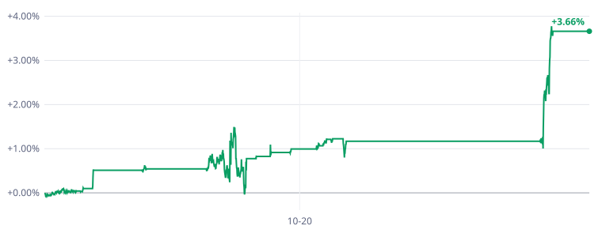

# 수익률 보고서

2026-10-23 18:49 기준 (한국 시각) · LS 모의계좌 · MNQ · 시작 자금 $100,000

| 대회 기준 수익률 | LS 계좌 수익률 | MDD (1분봉 평가) | 체결 |
| --- | --- | --- | --- |
| **+5.02%** (+$5,023) | +5.57% | -4.07% (-$4,249) | 75건 · 548계약 |

| 날짜 | 체결 | 계약 | 대회 기준 실현 손익 ($) | 시작 자금 대비 |
| --- | --- | --- | --- | --- |
| 10-23 | 19건 | 261 | +787.5 | +0.79% |
| 10-22 | 13건 | 93 | +575.5 | +0.58% |
| 10-20 | 20건 | 76 | +2,666.0 | +2.67% |
| 10-19 | 23건 | 118 | +994.0 | +0.99% |

대회 기준 = 증권사 수수료와 대회 차감(체결 1계약당 각 $1)을 뺀 값. 날짜별 손익은 그날 닫은 몫만 세고, 들고 있는 포지션의 평가 손익은 닫는 날에 들어간다.
갱신: 서버를 켠 채 `python -m mnq.report`
